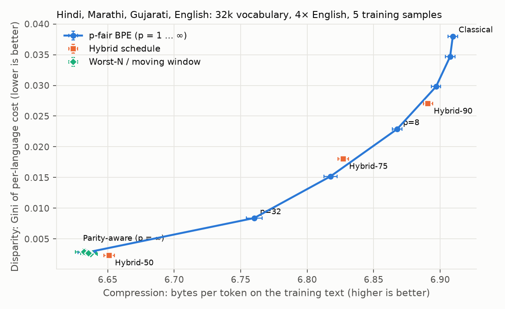
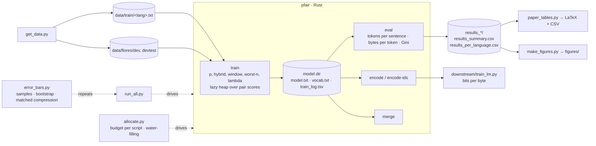

# p-fair BPE

A multilingual BPE tokenizer with one dial, `p`: `p = 1` is classical BPE (best total
compression), `p = ∞` is Parity-aware BPE (equal token cost for every language), and the
values in between trade one for the other along a single objective. The trainer is a
dependency-free Rust program with exact lazy evaluation; the scripts download the data
(Sangraha, FLORES-200), run the sweeps and produce the tables and figures.



## Architecture



## Installation

```bash
curl --proto '=https' --tlsv1.2 -sSf https://sh.rustup.rs | sh     # Rust, if missing
pip install pyarrow huggingface_hub numpy                              # + matplotlib (figures), torch transformers (LM)
git clone https://github.com/Siddhant-812/pfair-bpe && cd pfair-bpe
cargo build --release
```

## Training

```bash
python get_data.py --langs hin,mar,guj,eng --eng-chars-m 80 --chars-m 20     # once; writes data/

target/release/pfair train --langs hin,mar,guj,eng --train-dir data/train --dev-dir data/flores/dev \
    --unit line --p 8 --vocab-size 32000 --out models/p8
```

| Flag | Tokenizer |
|---|---|
| `--p 1` | classical BPE |
| `--p 2 … 128` | p-fair BPE |
| `--p inf` | Parity-aware BPE |
| `--p inf --hybrid 0.75` | hybrid schedule (75% classical merges, then parity) |
| `--p inf --window 100 --alpha 2` | moving-window Parity-aware BPE |
| `--p inf --worst-n 2` | Worst-N parity |
| `--lambda 0.5 --morph-lexicon FILE` | morphology penalty on top of any rule |

`--unit line` measures cost in tokens per parallel sentence; `byte` and `char` are the
alternatives. Text files are `DIR/<lang>.txt`, one sentence per line; language codes are
listed in `get_data.py`.

## Evaluation

```bash
target/release/pfair eval --langs hin,mar,guj,eng --model models/p8 --test-dir data/flores/devtest \
    --unit line --train-dir data/train --summary summary.csv --detail per_language.csv

target/release/pfair encode --model models/p8 --input text.txt
```

## Experiments

```bash
# sweep p and the baselines in one go (data download, training, evaluation)
python run_all.py --ps 1,2,4,8,16,32,inf --hybrids 0.5,0.75,0.9 --worst-ns 2,3 --window 100 --out results_main
python run_all.py --vocab-size 128000 --out results_128k
python run_all.py --eng-chars-m 20 --data data_eng1 --out results_eng1
python run_all.py --unit byte --out results_byte

# mean and spread over 5 samples of training text, baselines vs the p-fair front at matched compression
python error_bars.py --samples 5 --ps 1,2,4,8,16,32,inf --hybrids 0.5,0.75,0.9 \
    --run-args "--worst-ns 2,3 --window 100" --out results_main

# 14 languages, 10 scripts, natural data balance
L=hin,mar,guj,ben,pan,ori,asm,san,tam,tel,kan,mal,urd,eng
python run_all.py --langs $L --natural --total-chars-m 400 --vocab-size 64000 \
    --ps 1,2,4,8,16,32,64,128,inf --hybrids 0.5,0.75,0.9 --worst-ns 2,3,5 --window 100 \
    --data data_l14 --out results_l14
python compare_hybrid.py results_l14

# vocabulary allocation across scripts
python allocate.py --clusters "Deva=hin,mar;Gujr=guj;Latn=eng" --ps 1,8 --vocab-size 32000 --out results_alloc

# language model per tokenizer, bits per byte on FLORES (GPU)
python downstream/train_lm.py --tokenizer models/p8 --name "p=8" --langs hin,mar,guj,eng \
    --train-dir data/train --test-dir data/flores/devtest --out results_lm/p8 \
    --epochs 2 --layers 6 --dim 512 --heads 8 --seq-len 512 --batch-seqs 32
```

Every run writes `results_summary.csv` (one row per tokenizer) and
`results_per_language.csv` (tokens per sentence per language). `python run_all.py --help`
lists all options.

## Tables and figures

```bash
python paper_tables.py front --dir results_main       # perlang · regress · underserved · sens · alloc · lm
python make_figures.py --main results_main --l14 results_l14_eb
```
