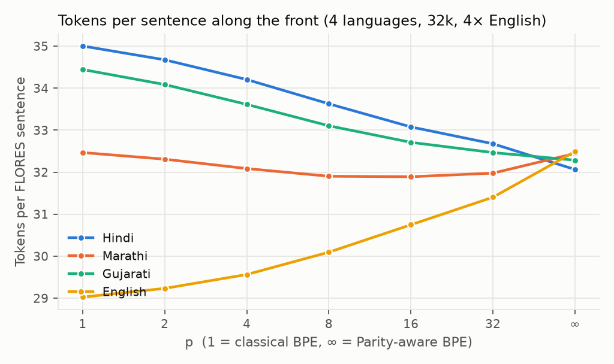
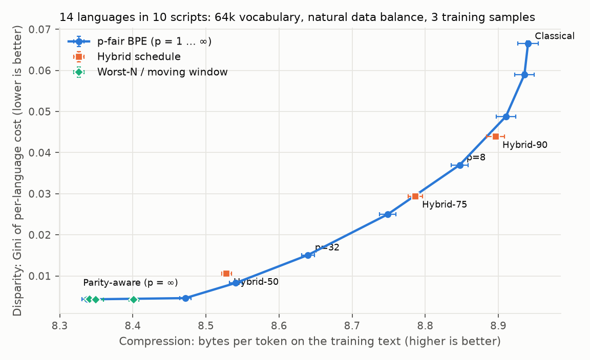
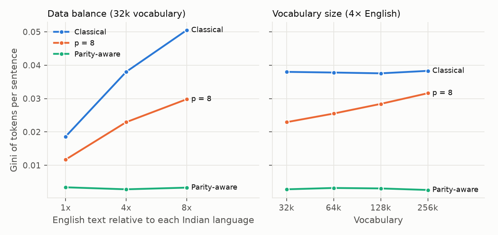

# p-fair BPE

A multilingual byte-pair-encoding tokenizer with one parameter, `p`, that moves the
vocabulary from classical BPE (`p = 1`) to Parity-aware BPE (`p = ∞`). Classical BPE gives
the best total compression; Parity-aware BPE gives every language the same token cost.
p-fair BPE covers the whole range in between with a single objective, trains exactly, and is
an order of magnitude faster than naive rescoring. The trainer is a dependency-free Rust
program; the experiments are Python scripts over public data (Sangraha for training,
FLORES-200 for evaluation).


## Problem

Subword tokenizers learn their merges from frequency counts, so a language with less
training text gets fewer merges and pays more tokens for the same content. Trained with four
times as much English as Hindi, classical BPE spends 35 tokens on a Hindi FLORES sentence and
29 on its English translation. Tokens are what pricing, latency and context length are
counted in, so speakers of under-served languages pay more for the same request.

Parity-aware BPE removes the gap by always helping the currently most expensive language, at
a loss in overall compression. The methods proposed between the two extremes (switching
rules after a fixed share of merges, taking the worst `N` languages, a moving window) are
heuristics without a stated objective. p-fair BPE replaces them with one objective whose
two limits are classical and Parity-aware BPE.

## Method

Let `t_l` be the current cost of language `l`, measured in tokens per parallel sentence on a
development set, and `π_l` its share of the training text. p-fair BPE minimises the power
mean of the per-language costs,

```
M_p(t) = ( Σ_l π_l · t_l^p )^(1/p)
```

The greedy step that follows is a one-line change to BPE. Each language's pair count is
weighted by that language's current cost to the power `p − 1`:

```
score(a, b) = Σ_l  t_l^(p−1) · c_l(a, b)
```

At `p = 1` every weight is 1 and the rule is classical BPE. As `p → ∞` the most expensive
language dominates and the rule becomes Parity-aware BPE. In between, every language keeps a
positive weight and the expensive ones count more.

Pair scores never increase under this rule, so training uses lazy evaluation: scores live in
a heap and a pair is re-scored only when it reaches the top. The merge list is identical to
full rescoring, and training is 26 to 67 times faster (5 s instead of 120 s for four
languages at a 32k vocabulary).

All tokenizers are the same rule with different settings:

| Flag | Tokenizer |
|---|---|
| `--p 1` | classical BPE |
| `--p 2 … 128` | p-fair BPE |
| `--p inf` | Parity-aware BPE |
| `--p inf --hybrid 0.75` | hybrid schedule: first 75% of merges classical, rest parity |
| `--p inf --window 100 --alpha 2` | moving-window Parity-aware BPE |
| `--p inf --worst-n 2` | Worst-N parity |
| `--lambda 0.5 --morph-lexicon FILE` | any of the above with a morphology penalty |

## Results

Raising `p` traces a monotone front between compression (bytes per token) and disparity
(Gini coefficient of tokens per sentence across languages). On Hindi, Marathi, Gujarati and
English at 32k, `p = 8` cuts the Gini by 40% for a 0.6% loss in compression; full parity costs
4%. p-fair BPE lowers the cost of the under-served languages and raises English, and it never
makes a language that is already above the classical mean cost more expensive. The hybrid
schedule reaches similar points on the front but does raise some under-served languages.



With 14 languages in ten scripts at their natural data balance the picture is the same. The
p-fair and hybrid fronts coincide to within 0.003 in Gini at equal compression; p-fair is
strictly fairer than every hybrid point at a 128k vocabulary.



The size of the disparity, and the price of removing it, depend more on the setting than on
the merge rule: parity costs 1% of compression with equal text per language, 4% with four
times as much English and 7% with eight times; intermediate `p` loses equity as the
vocabulary grows while Parity-aware BPE does not; and measuring cost per byte instead of per
sentence inverts the disparity, because Indic scripts take three UTF-8 bytes per character.



Model quality is unchanged. A 36M-parameter language model trained with each tokenizer on
identical text reaches 1.013 to 1.018 bits per byte on FLORES for classical, `p = 8`,
`p = 32`, hybrid and Parity-aware BPE alike, while two seeds of one tokenizer differ by 0.003.

## Installation

```bash
curl --proto '=https' --tlsv1.2 -sSf https://sh.rustup.rs | sh     # Rust, if not installed
pip install pyarrow huggingface_hub numpy                              # matplotlib for figures, torch transformers for the LM
git clone https://github.com/Siddhant-812/pfair-bpe && cd pfair-bpe
cargo build --release
```

Data is downloaded on first use: FLORES-200 dev and devtest, and a sample of the verified
split of Sangraha from Hugging Face (about 30 MB per language). Everything else runs offline.

## Usage

### Train and evaluate one tokenizer

```bash
python get_data.py --langs hin,mar,guj,eng --eng-chars-m 80 --chars-m 20   # data/train, data/flores

target/release/pfair train --langs hin,mar,guj,eng --train-dir data/train --dev-dir data/flores/dev \
    --unit line --p 8 --vocab-size 32000 --out models/p8

target/release/pfair eval  --langs hin,mar,guj,eng --model models/p8 --test-dir data/flores/devtest \
    --unit line --train-dir data/train --summary summary.csv --detail per_language.csv

target/release/pfair encode --model models/p8 --input some_text.txt
```

`--unit line` measures cost in tokens per parallel sentence (the setting used throughout);
`byte` and `char` are the alternatives. Text files are `DIR/<lang>.txt`, one sentence per
line; language names are the three-letter codes listed in `get_data.py`.

### Sweep p and the baselines

```bash
python run_all.py                                              # classical, p=2, p=4, Parity-aware; 4 languages, 32k
python run_all.py --ps 1,2,4,8,16,32,inf --hybrids 0.5,0.75,0.9 --worst-ns 2,3 --window 100 --out results_main
python run_all.py --vocab-size 128000 --out results_128k       # other vocabulary sizes
python run_all.py --eng-chars-m 20 --data data_eng1 --out results_eng1      # other data balances
python run_all.py --unit byte --out results_byte               # other cost units
```

Each run writes `results_summary.csv` (one row per tokenizer: Gini per sentence, bytes per
token, and more), `results_per_language.csv` (tokens per sentence of each language) and the
model folders. `python run_all.py --help` lists every option.

### Error bars

Repeats a run on several non-overlapping samples of training text, reports mean and standard
deviation, and compares each baseline with the p-fair front at matched compression:

```bash
python error_bars.py --samples 5 --ps 1,2,4,8,16,32,inf --hybrids 0.5,0.75,0.9 \
    --run-args "--worst-ns 2,3 --window 100" --out results_main
```

### Many languages at natural data balance

```bash
L=hin,mar,guj,ben,pan,ori,asm,san,tam,tel,kan,mal,urd,eng
python run_all.py --langs $L --natural --total-chars-m 400 --vocab-size 64000 \
    --ps 1,2,4,8,16,32,64,128,inf --hybrids 0.5,0.75,0.9 --worst-ns 2,3,5 --window 100 \
    --data data_l14 --out results_l14
python compare_hybrid.py results_l14
```

### Vocabulary allocation across scripts

Fits a cost curve per script, splits the vocabulary budget by water-filling, trains one
tokenizer per script and merges them:

```bash
python allocate.py --clusters "Deva=hin,mar;Gujr=guj;Latn=eng" --ps 1,8 --vocab-size 32000 --out results_alloc
```

### Language-model check (GPU)

```bash
python downstream/train_lm.py --tokenizer models/p8 --name "p=8" --langs hin,mar,guj,eng \
    --train-dir data/train --test-dir data/flores/devtest --out results_lm/p8 \
    --epochs 2 --layers 6 --dim 512 --heads 8 --seq-len 512 --batch-seqs 32
```

Reports bits per byte per language on FLORES devtest, which is comparable across tokenizers.

### Tables and figures

```bash
python paper_tables.py front --dir results_main        # also: perlang, regress, underserved, sens, alloc, lm
python make_figures.py --main results_main --l14 results_l14_eb
```

Training is deterministic given the data; `reference_results/` holds the outputs of the
default run and of the four-language sweep for comparison.
